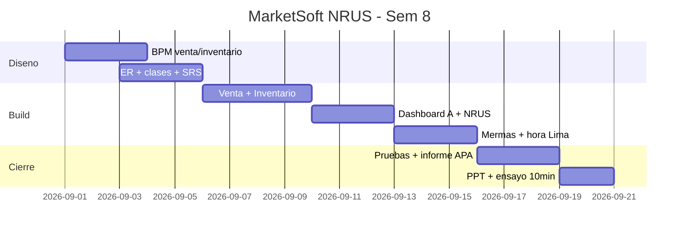
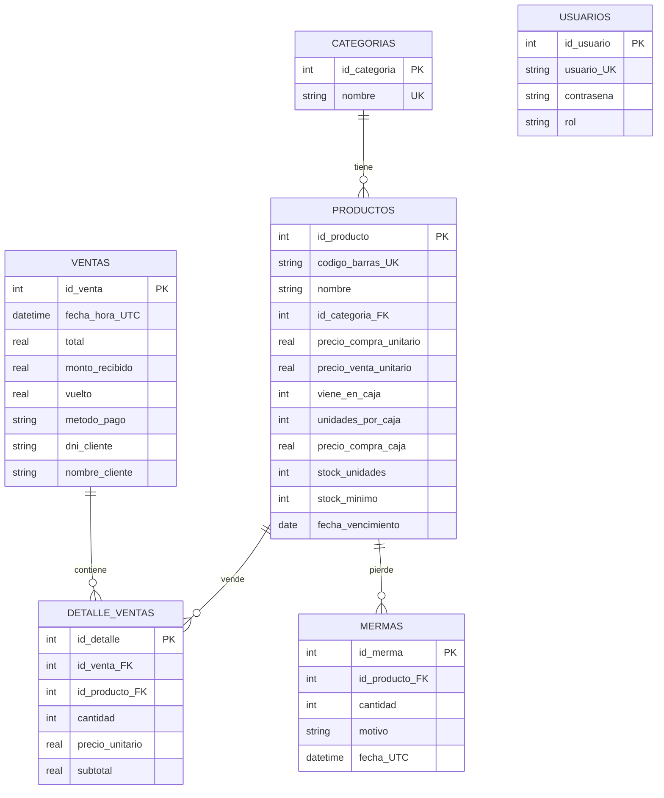
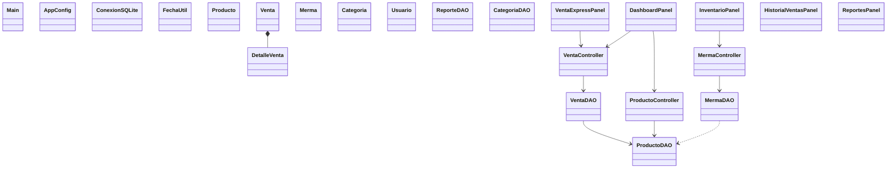

# APF2-03 — Diseño de la solución (charter, gantt, BPM, ER, clases)

## 1. Project Charter básico
| Campo | Contenido |
|---|---|
| Proyecto | MarketSoft NRUS — POS + inventario para bodegas (NRUS Cat.1) |
| Objetivo | Arqueo en 3 min, 0 quiebres top-100, margen visible, no exceder S/. 8,000 |
| Alcance | Login, Venta, Inventario, Dashboard A, Historial, Reportes, hora Lima |
| Fuera | Fact. electrónica, multitienda, delivery |
| Stack | Java 21, Swing + FlatLaf 3.4.1, SQLite 3.45.3, JCalendar 1.4, Maven shade, MVC+DAO |
| Riesgos | Exceder NRUS, merma oculta, UTC vs Lima, PC único |
| Éxito | Venta <60 s, arqueo cuadra, ganancia y NRUS correctos |

## 2. Gantt (Mermaid)

## 3. BPM (notación + procesos)
**Notación usada:** pool/carril (Cliente/Cajero/Sistema), tarea usuario/servicio,
compuerta exclusiva XOR (¿stock? ¿monto OK? ¿excede NRUS?), evento inicio/fin,
temporizador (revisar vencimiento), objeto de datos (ticket, merma).
**TO-BE Venta:** Cliente pide → Cajero busca (nombre/código) → Sistema valida stock
(XOR sin stock → sugiere sustituto) → agrega → cobra Efectivo/Yape/Plin →
Sistema valida monto (XOR insuficiente → pide faltante) → registra transacción
atómica + descuenta stock → ticket + actualiza KPIs/NRUS Lima.
**TO-BE Inventario/merma:** Admin crea (Unidad/Caja, costo auto) → ingresa por CAJAS
→ Sistema convierte a unidades → venta descuenta → si vence/rompe, retira como
merma con motivo → Sistema inserta merma + descuenta (atómico) → reporte pérdida.

## 4. Base de datos — lógico y físico (SQLite)

**Físico:** ver `src/main/resources/schema.sql`. Claves FK con `PRAGMA foreign_keys=ON`,
`ON DELETE CASCADE` en detalle, `UNIQUE` en código/usuario/categoría,
`CHECK(metodo_pago IN ...)`, `CHECK(rol IN ...)`. **Seguridad:** `PreparedStatement`
siempre, transacciones venta/merma, validación DNI/longitud, roles Admin/Cajero,
DB fuera del JAR en `%APPDATA%`. **Hora:** se guarda UTC (`CURRENT_TIMESTAMP`) y se
lee/filtra en Lima (`FechaUtil.utcALima`, `date(...,'-5 hours')`) — Perú sin DST.

## 5. Clases UML — MVC + DAO (Mermaid)

**Buenas prácticas:** DAO solo SQL, Controller valida/calcula (costo caja/unid,
vuelto, ganancia), View solo UI con `UiHelper`; sin SQL en vistas.
